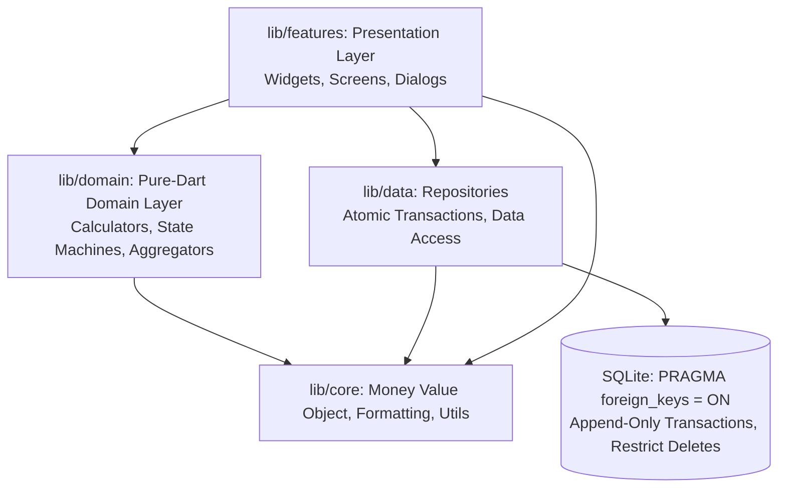
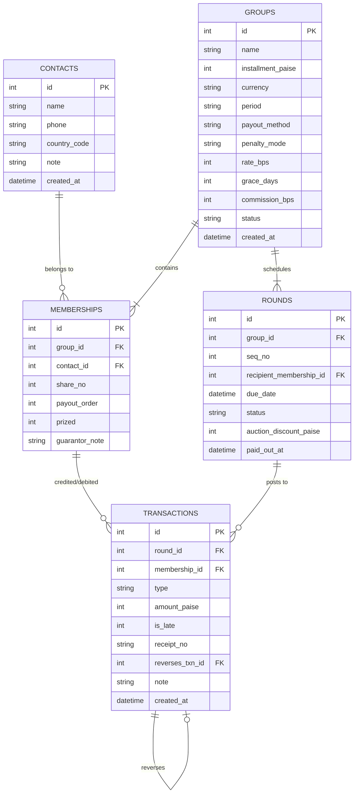

# Architecture Blueprint: Chit Notebook (சிட்டு நோட்புக்)

Chit Notebook is engineered with a **Feature-First Clean Architecture** designed specifically for high financial reliability, offline resilience, and strict domain purity.

---

## 🏛️ System Architecture Overview



### Core Architecture Principles

1. **Pure-Dart Domain (`lib/domain/`):**
   - Strictly **zero Flutter imports** (`package:flutter` is banned in `lib/domain/`).
   - Domain logic contains only pure business invariants, calculators, and state transition logic.
   - 100% unit-testable without mock engines or UI harness.

2. **Integer-Centric Currency (`lib/core/money/money.dart`):**
   - **No floating-point `double` for currency.**
   - All amounts are stored and computed in integer **paise** ($1\text{ INR} = 100\text{ paise}$).
   - Indian Lakh formatting grouping ($##,##,###$) handled safely at the presentation boundary.

3. **Immutable Append-Only Ledger (`transactions`):**
   - Balances are **derived dynamically from ledger rows; never stored as mutable column state**.
   - Corrections and late-fee waivers append reversal rows (`reverses_txn_id`).
   - `UPDATE` and `DELETE` queries are prohibited on the transactions table.

4. **Referential Integrity & Safe Deletion:**
   - Enforced by SQLite `PRAGMA foreign_keys = ON;` in `onConfigure`.
   - `ON DELETE RESTRICT` protects groups, rounds, and memberships from deletion once financial transactions have posted.

---

## 📂 Directory Layout

```text
lib/
├── app.dart                    # MaterialApp.router, Riverpod ProviderScope, theme listener
├── main.dart                   # SQLite initialization, runZonedGuarded entrypoint
├── core/                       # Shared foundational utilities
│   ├── l10n/                   # ARB localization files (app_en.arb, app_ta.arb)
│   ├── money/                  # Integer paise Money value object
│   ├── providers/              # Riverpod dependency injection providers
│   ├── theme/                  # Material 3 light/dark palette & controller
│   └── utils/                  # WhatsApp deep links, date clampers, disclaimer banner
├── data/                       # Data persistence and storage contracts
│   ├── database/               # DatabaseHelper, DDL Schema v2, integrity hooks
│   ├── models/                 # SQLite entities (ChitGroup, Contact, Membership, ChitRound, LedgerTxn)
│   └── repositories/           # ContactRepository, GroupRepository, RoundRepository, LedgerRepository
├── domain/                     # Pure Dart domain services (Zero Flutter imports)
│   ├── models/                 # Pure domain models (enums.dart, member_balance.dart)
│   └── services/               # LateFeeCalculator, RoundsGenerator, RoundStateMachine, LedgerAggregator
├── features/                   # Feature-first modules
│   ├── group/                  # NewChitScreen (wizard), GroupDetailScreen
│   ├── home/                   # HomeScreen, Dashboard, Disclaimer, Stats Cards
│   ├── member/                 # MemberLedgerScreen (plain-language accounting, prized tracking)
│   ├── round/                  # RoundDetailScreen (collection checklists, late-fee modal, pot payout)
│   └── settings/               # SettingsScreen (language switch, theme selector, backup/restore)
└── routing/                    # GoRouter configuration and route definitions
```

---

## 🔄 State Management & Dependency Injection

- **Riverpod (`flutter_riverpod: ^2.5.1`):** Provides singleton repositories and pure calculators to presentation widgets.
- **`ChangeNotifier` for System Settings:** `AppThemeController` and `AppLocaleController` provide low-overhead reactive state changes for dark/light themes and Tamil/English localization.
- **`go_router: ^14.2.0`:** Declarative type-safe routing decoupling navigation from UI hierarchy.

---

## 🗄️ Database Design (v2 Hardened Schema)

### Tables & Relationships



### Critical Database Constraints
1. **Integer Currency:** `installment_paise > 0`, `amount_paise > 0`, `auction_discount_paise >= 0`.
2. **Order Uniqueness:** `UNIQUE (group_id, payout_order)` ensures no turn collisions.
3. **Round Uniqueness:** `UNIQUE (group_id, seq_no)` guarantees clean round indexing.
4. **Referential Restriction:** Foreign keys use `ON DELETE RESTRICT` — a chit group with posted transactions can **never** be deleted from SQLite.

---

## 🛡️ Security, Privacy & Compliance Guidelines

- **Offline-First:** All financial computations, ledger aggregation, and records are stored strictly on-device in SQLite. No third-party servers, cloud sync, or remote APIs.
- **Zero Telemetry / No PII Leakage:** No analytics SDKs, trackers, or ad IDs.
- **WhatsApp Integration:** Deep links are constructed purely as URI strings (`https://wa.me/...`) passed directly to the OS browser/app launcher. No contact books are transmitted.
- **Financial Disclaimer:** Prominently surfaced across dashboards and receipts stating that the app is solely an organizer's ledger, not a payment app or regulated NBFC chit fund.

