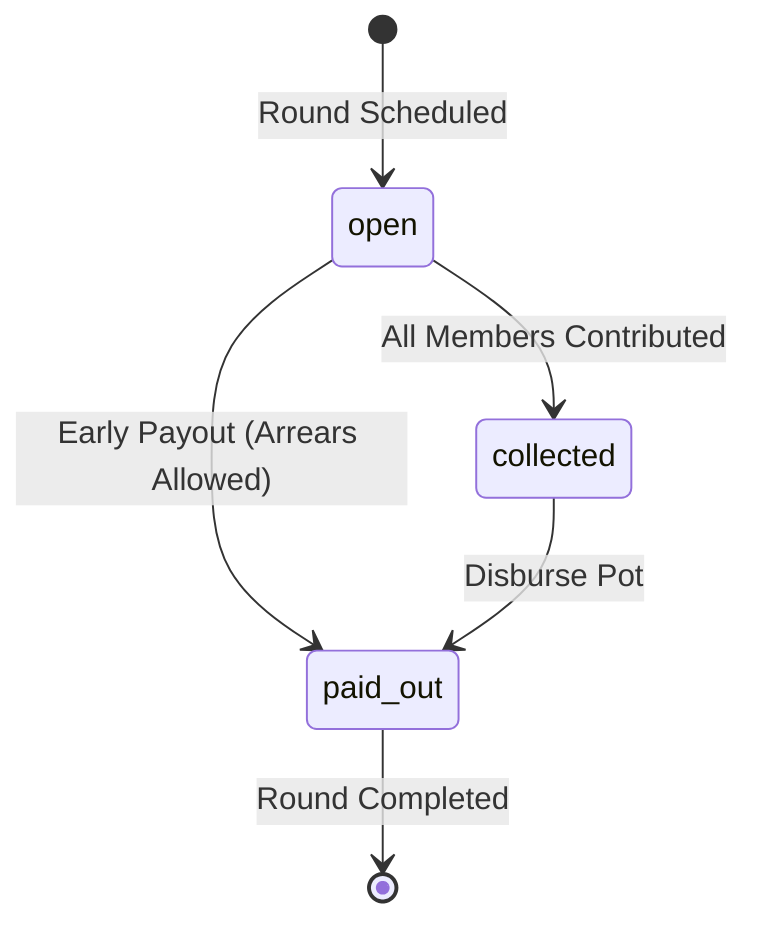

# Domain Rules & Financial Invariants: Chit Notebook

This document specifies the exact business logic and fintech invariants governing **Chit Notebook (சிட்டு நோட்புக்)**. All calculations are implemented in pure Dart (`lib/domain/`) and verified by comprehensive test suites.

---

## 1. Integer-Centric Accounting (The Zero-Drift Rule)

1. Money is strictly stored as **integer paise** ($1\text{ INR} = 100\text{ paise}$).
2. Floating-point numbers (`double` / `float`) are **strictly prohibited** for money storage and arithmetic.
3. Multiplication with rates (e.g. basis points) must explicitly specify rounding:
   - Round to nearest paise: `(paise * bps) ~/ 10000` or `.round()`.
   - Interest and late fees round to whole rupees where customary: `((paise + 50) ~/ 100) * 100`.

---

## 2. Payout Methods (`payout_method`)

Each chit group is configured with one of three payout rotation methods:

1. **`fixed_order` (M1 Default):**
   - Members are assigned an ordinal turn (`payout_order` $\in [1 \dots N]$).
   - In round $k$, member with `payout_order == k` is designated the recipient.
2. **`lottery` (Milestone 2):**
   - In each round, unprized members enter a random draw.
   - Winner is selected transparently and excluded from subsequent draws.
3. **`auction` (Milestone 2):**
   - Members submit discount bids to win early pot payouts.
   - Payout = $\text{Total Pot} - \text{Winning Discount}$.

---

## 3. Auction Bidding & Dividend Distribution (Milestone 2 Specification)

When an auction takes place:
1. Members bid a discount $D$ (e.g. ₹4,000 off a ₹25,000 pot).
2. The pot payout disbursed to winner is:
   $$\text{Winner Payout} = \text{Total Pot} - D$$
3. Foreman commission $C$ is computed from basis points:
   $$C = \frac{\text{Total Pot} \times \text{commission\_bps}}{10,000}$$
4. Distributable dividend pot:
   $$\text{Dividend Pool} = D - C$$
5. Per-member dividend distribution:
   $$\text{Base Dividend} = \lfloor \text{Dividend Pool} / M \rfloor$$
   $$\text{Remainder Paise} = \text{Dividend Pool} \pmod M$$
   *Where $M$ is the count of eligible members based on group rule (`all_members` vs `non_winners_only`).*
6. **Remainder Rule:** The residual remainder paise ($1 \dots M-1$) is credited to the lowest `payout_order` member to guarantee zero-sum ledger balance without fractional paise loss.

---

## 4. Penalty Modes & Dynamic Overdue Calculation (`penalty_mode`)

### Modes:
1. `none`: No overdue charges or interest.
2. `late_fee`: Overdue members pay prorated daily late fees upon collection.
3. `recipient_pays`: Winner pays interest on pot borrowed, distributed as dividends to savers.

### Dynamic Late-Fee Formula:
Given:
- $\text{Installment } P$ (in paise)
- $\text{Monthly Rate } R_{bps}$ (e.g., $200\text{ bps} = 2.0\%$ monthly)
- $\text{Due Date } D_{due}$
- $\text{Collection Date } D_{curr}$
- $\text{Grace Days } G$

$$\text{Days Overdue} = \max(0, (D_{curr} - D_{due})\text{.inDays})$$

If $\text{Days Overdue} \le G$:
$$\text{Late Fee} = 0$$

If $\text{Days Overdue} > G$:
$$\text{Late Fee} = \left\lfloor \frac{P \times R_{bps} \times \text{Days Overdue}}{30 \times 10,000} \right\rfloor$$

*Foreman has full discretion to waive late fee (e.g. close family) which records zero or offsetting reversal.*

---

## 5. Append-Only Ledger & Reversals (`transactions`)

1. The transaction ledger is **strictly append-only**.
2. Rows are never mutated via `UPDATE` or purged via `DELETE`.
3. To unmark an accidental collection or waive a previously posted late fee:
   - An offsetting reversal row is appended.
   - `reverses_txn_id` points directly to the original transaction ID.
   - `LedgerAggregator` filters both the original and reversal transaction out of active balance computation.

---

## 6. Derived Balances (Event Sourcing)

No member balance column exists in SQLite. Balances are derived dynamically by aggregating active transactions:

$$\text{Paid So Far} = \sum \text{amount\_paise}(\text{type} \in \{\text{contribution}, \text{interest}\})$$

$$\text{Received So Far} = \sum \text{amount\_paise}(\text{type} \in \{\text{payout}, \text{dividend}\})$$

$$\text{Net Balance} = \text{Received So Far} - \text{Paid So Far}$$

---

## 7. Round States & Arrears-Tolerant Payouts

Round states follow a strict forward progression:

### Arrears Tolerance Rule (No Deadlock):
- An organizer can disburse the pot payout (`paid_out`) even if one or more members are late (`arrears > 0`).
- Unpaid members retain their arrears and can be marked as paid at any time after pot disbursement.

---

## 8. Prized Status & Post-Prize Outstanding

1. Once a member receives a pot payout, their membership is marked `prized = 1`.
2. A prized member has converted from a "saver" to a "borrower".
3. **Post-Prize Outstanding:**
   $$\text{Remaining Rounds} = \text{Total Rounds} - \text{Past Due Rounds}$$
   $$\text{Post-Prize Obligation} = \text{Remaining Rounds} \times \text{Installment}$$
4. The organizer ledger displays this metric prominently to prevent default risk.

---

## 9. Plain-Language Financial Terminology

To remain accessible to non-technical and older foremen in Tamil Nadu/India, technical accounting jargon is translated into clear, human-understandable terms:

| Technical Concept | English (Plain Language) | Tamil (எளிய தமிழ்) |
| :--- | :--- | :--- |
| Debit / Contribution | **Paid so far** | இதுவரை செலுத்தியது |
| Credit / Payout | **Received so far** | இதுவரை பெற்றது |
| Receivables / Deficit | **Still to receive / To pay** | இன்னும் செலுத்த வேண்டியது |
| Overdue Installment | **Pending / Arrears** | நிலுவை |
| Collateral / Security | **Guarantor Note** | ஜாமீன் குறிப்பு |

