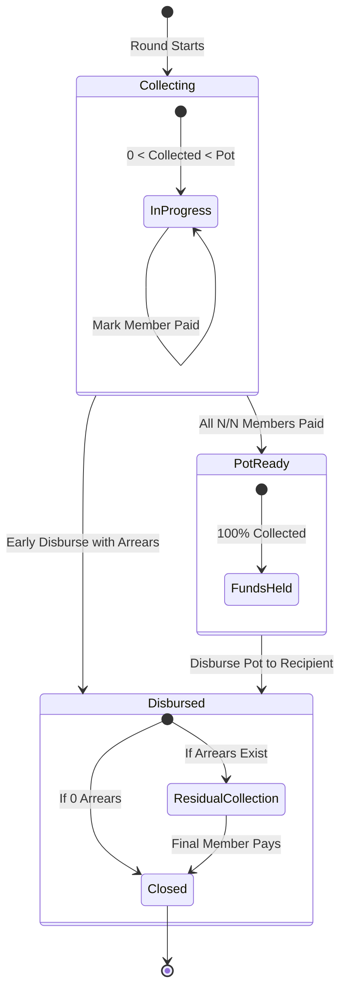

# Chit Notebook (சிட்டு நோட்புக்)

An offline-first, privacy-focused digital ledger and collection manager for family, friends, and community chit funds (ROSCAs — Rotating Savings and Credit Associations).

> **"Money moves outside the app; the app is the ledger."**  
> Built for the chit organizer (foreman). Members receive clean, instant statements and receipts via WhatsApp deep links.

---

## 📑 Table of Contents

- [Overview & What is a ROSCA?](#-overview--what-is-a-rosca)
- [Key Features](#-key-features)
- [Financial & Domain Logic](#-financial--domain-logic)
  - [1. Interest & Penalty Modes](#1-interest--penalty-modes)
  - [2. Dynamic Prorated Late-Fee Engine](#2-dynamic-prorated-late-fee-engine)
  - [3. Closed-Loop Dividend Math](#3-closed-loop-dividend-math)
  - [4. Dynamic Net Balance Derivation](#4-dynamic-net-balance-derivation)
- [Round Lifecycle State Machine](#-round-lifecycle-state-machine)
- [Database Architecture & Ledger Schema](#-database-architecture--ledger-schema)
- [UI & Screen Walkthrough](#-ui--screen-walkthrough)
- [WhatsApp Automation Engine](#-whatsapp-automation-engine)
- [Backup, Restore & Disaster Recovery](#-backup-restore--disaster-recovery)
- [Project Directory Layout](#-project-directory-layout)
- [Getting Started](#-getting-started)
- [Testing & Quality Assurance](#-testing--quality-assurance)
- [License](#-license)

---

## 💡 Overview & What is a ROSCA?

A **Rotating Savings and Credit Association (ROSCA)**, known locally across South Asia as a **Chit Fund (சீட்டு நிதி)**, is a peer-to-peer banking mechanism where a fixed group of individuals contribute a set installment into a common pot at regular intervals (monthly or weekly). Each round, one member takes the entire pot, rotating until every participant has received the payout once.

Chit Notebook replaces traditional paper diaries and error-prone spreadsheets with:
- An **immutable append-only financial ledger** (`transactions`)
- Strict referential safety enforced by SQLite foreign keys
- Dynamic arrears and dividend calculations that never go out of sync
- Zero cloud servers, tracking scripts, or recurring costs

---

## 🌟 Key Features

- **🔒 100% Offline & Private:** Powered by on-device SQLite. Financial data stays entirely on the user's phone.
- **🌗 Dark / Light / System Mode:** Native Material 3 theming with persistent theme preferences (`AppThemeController`).
- **🌐 Bilingual (English & தமிழ்):** Seamless runtime switching between English (India, ₹ INR) and Tamil (தமிழ்).
- **🛡️ Destructive Action Protection:** Chit deletion is moved into an overflow menu (`...`) and requires typing the exact chit name before confirmation.
- **📐 Immutable Event Ledger:** Balances are never updated in place; they are computed dynamically from immutable credit/debit records.
- **⏰ Dynamic Prorated Late-Fee Calculation:** Calculates daily overdue penalties with options to collect or waive fees.
- **🔄 Decoupled Arrears Payout:** Organizers can disburse the pot on schedule even if some members have pending contributions, recording late collections without deadlock.
- **📲 Direct WhatsApp Integration:** Generates localized reminder and receipt deep links (`wa.me/91...?text=...`) without third-party SMS gateway fees.
- **💾 JSON Backup & Restore:** Export and import full database snapshots for effortless device-to-device migration.

---

## 🧮 Financial & Domain Logic

### 1. Interest & Penalty Modes

When creating a chit group, organizers select between three standard community models:

| Mode | Behavior | Use Case |
| :--- | :--- | :--- |
| `none` | Zero interest, zero penalties. Fixed contributions and payouts. | Close family and trusted informal groups. |
| `late_fee` | Default. Members paying after the due date incur a daily prorated late penalty. | Standard community chits to incentivize on-time collections. |
| `recipient_pays` | The member taking the pot pays interest on the borrowed funds, which is distributed evenly as dividends to all other members. | ROSCAs where early pot recipients pay a borrowing fee that yields returns for late savers. |

---

### 2. Dynamic Prorated Late-Fee Engine

Instead of charging an arbitrary flat penalty, late fees are calculated against the monthly rate prorated over the exact days overdue:

$$\text{Daily Rate} = \frac{\text{Monthly Rate (\%)}}{30 \times 100}$$

$$\text{Late Fee} = \text{Base Installment} \times \text{Daily Rate} \times \text{Days Overdue}$$

$$\text{Total Amount Due} = \text{Base Installment} + \text{Late Fee}$$

When an organizer marks an overdue member as paid, a breakdown modal presents:
1. **Base Installment** (e.g. ₹5,000)
2. **Late Penalty** (e.g. +₹50 for 15 days overdue @ 2% monthly)
3. **Total Amount Due** (e.g. ₹5,050)
4. Explicit choices: **Collect Total**, **Waive Late Fee** (for family/leniency), or **Cancel**.

---

### 3. Closed-Loop Dividend Math

In `recipient_pays` mode, internal zero-sum balance is mathematically guaranteed:

$$\text{Recipient Interest} = \text{Total Pot} \times \frac{\text{Interest Rate (\%)}}{100}$$

$$\text{Dividend per Member} = \frac{\text{Recipient Interest}}{N - 1}$$

Where $N$ is the total number of members in the chit. The recipient pays the interest, and each of the other $N - 1$ members receives an equal credit dividend row in the immutable ledger, satisfying:

$$\sum \text{Dividends Distributed} \equiv \text{Interest Paid by Recipient}$$

---

### 4. Dynamic Net Balance Derivation

Member accounts do not store a mutable balance column. A member's net position is calculated dynamically across all ledger entries:

$$\text{Total Credits} = \text{Pot Payouts Received} + \text{Dividends Earned}$$

$$\text{Total Debits} = \text{Contributions Paid} + \text{Interest / Late Fees Paid}$$

$$\text{Net Position} = \text{Total Credits} - \text{Total Debits}$$

- **Positive Net:** The member has taken the pot early and is in a net borrowing position.
- **Negative Net:** The member has contributed more than they have withdrawn and is in a net savings position.

---

## 🔄 Round Lifecycle State Machine

Each chit round moves through a strict 3-phase state machine to prevent race conditions:



### State Definitions

1. **`open` (Collecting):** Members are actively contributing. Marked with a Blue badge.
2. **`collected` (Pot Ready):** All members have paid their installment. The pot is 100% funded and ready for payout. Marked with an Orange badge.
3. **`paid_out` (Disbursed):** The pot has been handed over to the winning recipient. Marked with a Green badge (or Amber if arrears remain).
   - *Arrears Tolerance:* Disbursing the pot does not lock pending member tiles. Unpaid members can still be marked paid post-disbursement.

---

## 🗄️ Database Architecture & Ledger Schema

SQLite foreign key enforcement is initialized on connection:
```dart
onConfigure: (db) async => await db.execute('PRAGMA foreign_keys = ON');
```

```
┌───────────────────┐       ┌───────────────────────┐
│      groups       │       │        members        │
├───────────────────┤       ├───────────────────────┤
│ id (PK)           │◄──────│ group_id (FK)         │
│ name              │       │ payout_order (UNIQUE) │
│ contribution_amt  │       │ name, phone, role     │
│ interest_mode     │       └───────────┬───────────┘
│ period, status    │                   │
└─────────┬─────────┘                   │
          │                             │
          ▼                             ▼
┌───────────────────┐       ┌───────────────────────┐
│      rounds       │       │     transactions      │
├───────────────────┤       ├───────────────────────┤
│ id (PK)           │◄──────│ round_id (FK)         │
│ group_id (FK)     │       │ member_id (FK)        │
│ seq_no (UNIQUE)   │       │ type (contribution... │
│ recipient_id (FK) │       │ amount, is_late, note │
│ due_date, status  │       │ created_at            │
└───────────────────┘       └───────────────────────┘
```

### Table Definitions & Indices

- **`groups`:** Configuration, installment amount, rotation frequency, and interest rules.
- **`members`:** Roster ordered by fixed payout turn (`payout_order`), with `UNIQUE(group_id, payout_order)`.
- **`rounds`:** Scheduled installments with sequence numbers and assigned recipient, with `UNIQUE(group_id, seq_no)`.
- **`transactions`:** The immutable ledger. Event types:
  - `contribution`: Member installment payment.
  - `payout`: Pot disbursement to the round recipient.
  - `interest`: Late fee penalty or recipient borrowing cost.
  - `dividend`: Distributed profit share from recipient-paid interest.
- **Performance Indices:**
  - `idx_members_group`: Fast member roster queries.
  - `idx_rounds_group`: Round sequencing lookups.
  - `idx_txn_round`: Instant collection checklist aggregation.
  - `idx_txn_member`: Accelerated personal financial statement compilation.

---

## 📱 UI & Screen Walkthrough

| Screen | Description | Key Features |
| :--- | :--- | :--- |
| **Home Dashboard** ([`home_screen.dart`](file:///d:/codebase/chit-notebook/lib/features/home/home_screen.dart)) | Overview of all chit groups. | Summary stats card, progress bars, active round callout, and bottom navigation. |
| **New Chit Wizard** ([`new_chit_screen.dart`](file:///d:/codebase/chit-notebook/lib/features/group/new_chit_screen.dart)) | Group setup workflow. | Step-by-step inputs, drag-and-drop rotation ordering, and real-time pool preview. |
| **Group Details** ([`group_detail_screen.dart`](file:///d:/codebase/chit-notebook/lib/features/group/group_detail_screen.dart)) | Comprehensive chit control center. | Active round hero card, member list, full round history, and protected deletion modal. |
| **Round Operations** ([`round_detail_screen.dart`](file:///d:/codebase/chit-notebook/lib/features/round/round_detail_screen.dart)) | Core daily collection tracker. | Member checkboxes, dynamic late fee modal, recipient swapping, and pot payout modal. |
| **Member Ledger** ([`member_ledger_screen.dart`](file:///d:/codebase/chit-notebook/lib/features/member/member_ledger_screen.dart)) | Individual account statement. | Net position summary card, itemized timeline, and single-tap WhatsApp statement sharing. |
| **Settings** ([`settings_screen.dart`](file:///d:/codebase/chit-notebook/lib/features/settings/settings_screen.dart)) | App configuration & backup. | Light/Dark theme selector, English/Tamil language selector, JSON export, and JSON restore. |

---

## 📲 WhatsApp Automation Engine

Chit Notebook formats clean messages using WhatsApp URI deep links:
`https://wa.me/{91+digits}?text={encoded_message}`

Members do not need any special software installed.

### Message Templates

```
1. Upcoming Reminder:
   "Payment Reminder - Family Chit 2026
    Hello Meena 👋, installment for Round 3 is due on 06 Dec 2026.
    Amount: ₹5,000. Please pay on time to ensure smooth pot rotation."

2. Overdue Notice:
   "Overdue Notice - Family Chit 2026 ⚠️
    Hello Meena, Round 3 is overdue by 5 days.
    • Installment: ₹5,000
    • Late Fee (2% monthly): ₹17
    • Total Due: ₹5,017
    Kindly clear your balance at your earliest convenience 🙏"

3. Account Statement:
    Full breakdown including total contributed, total pot received,
    interest paid, dividends earned, and net balance.
```

---

## 💾 Backup, Restore & Disaster Recovery

- **Export:** Serializes all SQLite tables (`groups`, `members`, `rounds`, `transactions`) into an indented JSON payload with timestamp and version metadata. Shared instantly via Android/iOS share sheet (Google Drive, WhatsApp, Email, or Local Files).
- **Restore:** Built-in JSON importer parses the backup, runs structural validation, displays an overwrite warning, and restores records inside an atomic SQLite transaction.

---

## 📂 Project Directory Layout

```
lib/
├── main.dart                          # App initialization & preferences bootstrap
├── app.dart                           # MaterialApp with theme & locale builders
├── core/
│   ├── locale_controller.dart         # Language state manager (English / Tamil)
│   ├── theme_controller.dart          # Theme state manager (System / Light / Dark)
│   ├── strings.dart                   # Bilingual localization dictionary
│   └── utils.dart                     # Currency/date formatters, late-fee math, WhatsApp links
├── data/
│   ├── database/
│   │   ├── schema.dart                # SQLite DDL statements & indices
│   │   └── database_helper.dart       # DB lifecycle, foreign keys & JSON backup/restore
│   ├── models/
│   │   ├── chit_group.dart            # Group entity model
│   │   ├── chit_round.dart            # Round entity model
│   │   ├── member.dart                # Member entity model
│   │   └── ledger_txn.dart            # Immutable audit transaction model
│   └── repositories/
│       ├── group_repository.dart      # Chit creation, queries & safe deletion
│       ├── round_repository.dart      # Mark paid, dynamic fees, payouts & state changes
│       └── member_repository.dart     # Ledger queries & dynamic balance aggregation
└── features/
    ├── home/
    │   └── home_screen.dart           # Dashboard & bottom navigation
    ├── group/
    │   ├── new_chit_screen.dart       # Chit creation wizard
    │   └── group_detail_screen.dart   # Chit timeline & protected delete menu
    ├── round/
    │   └── round_detail_screen.dart   # Collection checklist & payout dialog
    ├── member/
    │   └── member_ledger_screen.dart  # Member statement & timeline
    └── settings/
        └── settings_screen.dart       # Theme, language, export & restore
```

---

## 🚀 Getting Started

### Prerequisites

- [Flutter SDK](https://docs.flutter.dev/get-started/install) (`>=3.0.0 <4.0.0`)
- Android Studio / VS Code with Flutter extension
- Physical Android/iOS device or emulator

### Installation

```bash
# 1. Clone the repository
git clone https://github.com/rajkrish63/chit-notebook.git
cd chit-notebook

# 2. Install dependencies
flutter pub get

# 3. Launch application
flutter run
```

---

## 🧪 Testing & Quality Assurance

The codebase includes comprehensive unit tests verifying financial math, calendar day calculations, model round-tripping, and localization:

```bash
# Run unit and widget tests
flutter test

# Run static analysis
flutter analyze
```

Both commands pass with **0 warnings and 0 errors**.

---

## 📄 License

This project is licensed under the [MIT License](LICENSE). Built for families, self-help groups (SHGs), and community savings groups worldwide.
